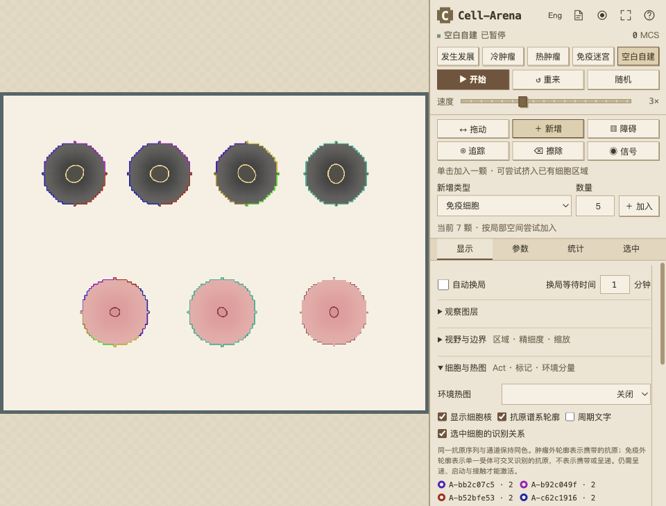

# 免疫胞体抗原匹配轮廓

2026-11-13。对照版本 `10ebe0c`。本轮只修改显示与说明，保留现有生物学模型修订 `2026-11-onset-calibration-antigen-visuals-2`，不改变突变、遗传、受体、启动、接触和杀伤规则。

## 颜色的含义

- 靶细胞有 4 个肽段槽位。例如 `[A, B, C, D]` 的第二槽位突变为 `[A, B′, C, D]`，不会清空其余槽位，也不会自动追加旧 B。自身抗原、遗传丢失槽位不画色段，重复的序列＋通道合并；肿瘤最多 4 色。
- 肿瘤／癌前的外轮廓表示携带的非自身抗原；颜色对应序列＋呈递通道，深浅对应当前呈递。低表达保留较浅的身份色。
- 免疫胞体的外轮廓表示一个固定受体可匹配的当前抗原，可能多于 4 色。这是交叉识别潜力，不是多个受体、携带抗原、呈递抗原或已经激活。当前没有匹配抗原时不画匹配色段。
- 两类胞体都按相对质心的角度分段；变形细胞各段的实际周长不一定相等。胞核只使用原有状态配色，关闭胞核仍保留匹配外轮廓。
- 本轮未增加 APC／树突状细胞、抗原摄取加工、淋巴结或 APC–T 接触呈递。现有共享暴露记录、有限受体候选和延迟启动是后台近似；趋化与 IL-2 不是抗原身份的传递。

真实肿瘤的抗原谱可以包含多个肽段，不能把“一个细胞”当成“一条抗原序列”。四槽位和 ATCG 短码是本项目的简化，不是实验测得的抗原数或真实核酸／蛋白序列。相关原始研究：[Bassani-Sternberg et al., 2016](https://www.nature.com/articles/ncomms13404)。树突状细胞携带肿瘤抗原并启动 T 细胞的过程可参见 [Roberts et al., 2016](https://pubmed.ncbi.nlm.nih.gov/27424807/)，该过程尚未在本项目中显式实现。

## 实现

`antigenVisuals()` 为肿瘤和免疫细胞提供统一的外轮廓样式。删除免疫核匹配色弧及其缓存，保留普通胞核绘制。原 GPU 每细胞固定 4 色的布局改为共享、可变长度色表，每个细胞保存位置、色段数和色表偏移；相同色段序列共用存储，复用缓冲区。若超过 GPU 容量则转入既有 Canvas 回退，不截掉匹配颜色。

图例、追踪面板、中文及英文帮助同步说明两类外轮廓的含义。追踪靶细胞时增加四槽位与单槽位替换说明。

## 验证

- `node --test tests/*.test.mjs`：394 项通过，0 失败。本机 Node 24.22.1，约 74.6 秒。
- 新／更新回归覆盖单槽位替换、其余抗原保留、遗传色彩稳定、观察不消耗模型随机数、8 色免疫外轮廓、周期坐标一致性、快照失效、死亡／无匹配隐藏、GPU 色表跨行与最高合法细胞 ID、容量溢出。
- `node scripts/build.mjs` 与 `node scripts/verify-build.mjs` 通过。
- Ego Lite 实际浏览器：Apple M5，WebGL2 / ANGLE Metal；以 `WEBGL_lose_context` 强制触发 Canvas 回退。两条路径均在胞体边缘检测到全部 8 种匹配色，胞核区域匹配色像素为 0。无匹配细胞的匹配色像素为 0；这些免疫细胞均未启动。
- 关闭胞核后，两条绘制路径仍显示全部色段；关闭抗原标记后匹配色消失。切换前后模拟时间、完整网格和细胞状态序列化结果完全相同。页面错误为空，中英文图例检查通过。
- 此次没有进行新的生物学校准或性能加速测量；不据此声称改变免疫激活率或提升大规模演化速度。

## 复现与成果

运行 `node scripts/build.mjs`，再用 `node scripts/serve.mjs --port=4178` 启动本地页面。通过页面导入 [visual-fixture.json](visual-fixture.json)，保持暂停并开启抗原轮廓。该固定夹具只是显示检查，不是肿瘤自然演化结果。

上排是两个共享四种抗原的肿瘤、另一个携带另外四种抗原的肿瘤，以及一个第二通道肿瘤。下排依次是匹配 8 种抗原、匹配第二通道，以及完全不匹配的免疫细胞。

- [浏览器像素与状态检查](visual-checks.json)
- [GPU 截图](immune-body-gpu.png)
- [Canvas 截图](immune-body-cpu.png)

