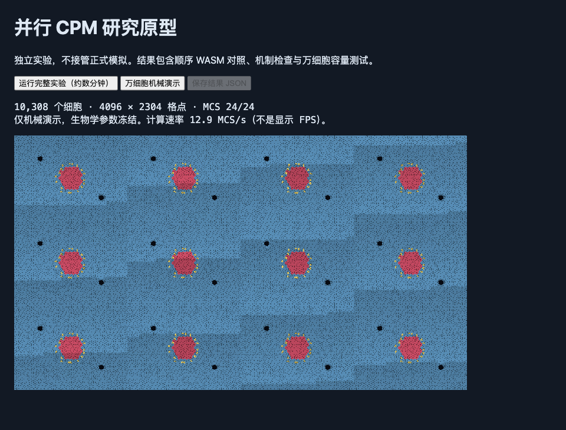

# 并行 CPM / GPU 后端实验：2026-11-13

**结论：原型可计算并显示 10,308 个细胞，但未达到替换现有后端的条件。完整生物学计算比已有 WASM 慢，万细胞机械计算只有约 12.7 MCS/s，动力学等价尚未建立。保留现有后端，把此目录作为后续研究的可复现基线。**

本轮没有改动生产 C/WASM 内核或其桥接层，也没有接入正式界面、构建或推送。之前的像素索引原型保持原样。`src/model.js` 的 SHA-256 仍为 `391e88c54f294a10d8aa75b54530172c2087cad695a2d86b853e769c429c9e68`；完整保留检查见 [preservation.json](preservation.json)。

## 选择与实现

选择 WebGPU/WGSL：可以使用当前 Mac 的 GPU，也符合项目的浏览器运行方式。参考 [Sultan 等的并行 CPM 研究](https://arxiv.org/html/2312.09317v1) 的随机分块思想；其论文强调局部更新时间统计对 Act 动力学的重要性。上游 [gpu-cpm](https://github.com/shabaz/gpu-cpm) 是 CUDA 实现，不能直接运行在本机 Apple GPU 上。本原型移植本项目的约束代码，没有复制该仓库的 CUDA 实现，也没有把文献中的加速倍数套用到本项目。

试验了两种调度：

1. `dense`：四颜色分块，每个活跃分块顺序采样局部复制提案；正式测量使用 4×4 分块、每阶段 4 次提案。
2. `boundary`：维护边界度数，使用带指数等待时间的边界事件，跨阶段保留剩余等待量。测试了批量 1、4、16；它减少无效提案，但没有带来稳定的完整流程收益。

完整移植了黏附、体积、周长、Act、方向驱动、截面、核区、形态分枝、连接能量和血管约束。体积及周长采用整数原子更新；最低面积另有并发保护。网格更新不能局部证明连通性时，将提案延迟到后续 GPU dispatch，重新检查并执行完整 BFS，而不是直接丢弃或放宽条件。使用 [WebGPU 的 dispatch 同步模型](https://www.w3.org/TR/webgpu/#synchronization)，不假设不同工作组存在隐式全局屏障。

现有 JS 模型仍持有完整生物学状态。GPU 返回接受日志，适配层逐次回放 `C.setpixi`，随后运行原有接触、截面、血管、环境、代谢、免疫、分裂、死亡及历史记录步骤。常驻 GPU 容量测试另行运行，两者不混为一项成绩。

## 实测结果

设备为 Apple M5，10 核 GPU，32 GB 内存；WebGPU 返回 Apple/Metal 硬件适配器，非软件后备。详见 [environment.json](environment.json)。主验证原始数据为 [final-run.json](final-run.json)，精简汇总为 [summary.json](summary.json)。主验证记录所有相关源文件及原 WASM 的 SHA-256。

完整生物学计算采用种子 17、29、77，各预热 24 MCS，再运行 360 MCS；CPU/GPU 在同一页面交替先后顺序，排除首尾完整状态审计的耗时。CPU 对照使用已有顺序 WASM 加上一轮像素索引原型，双方开关一致。下表为三个种子的平均单步耗时及对应吞吐。

| 完整模拟计算 | CPU WASM | GPU 原型 | GPU / CPU 吞吐比 |
|---|---:|---:|---:|
| 约 200 细胞，384×288 | 3.02 ms；331 MCS/s | 8.20 ms；122 MCS/s | 0.37×，每步慢 2.72 倍 |
| 约 850 细胞，1024×768 | 15.96 ms；62.6 MCS/s | 28.37 ms；35.3 MCS/s | 0.56×，每步慢 1.78 倍 |

约 850 细胞时，各种子 CPU 的单步 p99 为 23.4–25.6 ms，GPU 为 37.9–40.1 ms；原型没有改善计算耗时的长尾。此处“完整”指包含生物学的模拟计算，不包含正式应用的 Worker 消息、快照打包、界面与绘图。没有把它描述为真实可见 FPS。

常驻机械容量测试从真实 `hot` 场景取组织，按周期边界扩展为多个副本。细胞像素分辨率、种类、核区与初始面积保持不变。各规模预热 12 MCS、计时 60 MCS；冻结生物学参数，不运行分裂、免疫、环境和代谢反馈。

| 细胞数 | 格点数 / 网格 | GPU 机械 MCS/s | 平均单步 / p99 |
|---|---|---:|---:|
| 859 | 786,432；1024×768 | 114.0 | 8.77 / 13.1 ms |
| 3,436 | 3,145,728；2048×1536 | 35.4 | 28.26 / 35.7 ms |
| 10,308 | 9,437,184；4096×2304 | **12.7** | **78.92 / 93.8 ms** |

859 细胞的相同常驻机械对照：原 WASM 7.42 ms/MCS，GPU 8.77 ms/MCS，也没有加速。原内核的原始格点容量为 1,048,576，大规模列没有可直接运行的原版 CPU 对照，不提供外推“加速倍数”。

万细胞的显式 GPU 缓冲约 295 MiB，不含 CPU 副本、驱动及页面内存。其机械计算已超过 30 MCS/s 所要求的 33.3 ms 单步预算，加入完整生物学与同步后仍无证据支持每秒 30 个新状态。**本轮证明了万细胞机械容量，没有证明万细胞完整生物学的流畅运行。**

边界事件变体的探索测量仍约 13 MCS/s，完整小场景仍比 CPU 慢约 2.7 倍，见 [boundary-results.json](boundary-results.json)。缩小批量到 1 同样没有建立完整组织迁移统计的等价性，见 [full-small-batch1.json](full-small-batch1.json)。这些是探索阶段记录，主结论以 `final-run.json` 为准。

## 机制与动力学检查

| 检查 | 结果与边界 |
|---|---|
| 三场景各 4,096 个候选，两个调度方式 | 24,576 次能量/硬约束检查通过；其中两种调度使用相同候选，并非 24,576 个独立样本 |
| 能量差 | 最大绝对误差约 0.000241；预设容差为 `0.05 + 1e-5 × abs(reference)`；WGSL 使用 f32，原 WASM 使用 double |
| 截面、核区、连通性、血管判断 | 取样候选未发现与原实现不一致 |
| 全局连通性反例 | 远路仍连接的提案获准，切断桥梁的提案被拒；没有以拒绝全部模糊情况替代 BFS |
| 动态网格与日志回放 | 体积、周长、胞体连通、最低面积、核区、墙体及 Act 回放检查通过 |
| 分裂与清除 | 检查母女细胞目标面积、隐藏体积守恒，以及 GPU 回放后正常清除；完整流程也实际发生分裂与免疫杀伤 |
| 周期组织扩大 | 新增两项 Node 测试，覆盖跨边界完整胞体及最近副本的配对关系 |
| 回归检查 | 原有及上一轮新增的 383 项通过；本轮新增两项通过 |

这些结果说明采样条件下保留了能量项与硬约束，**不等于长期生物学动力学已等价**。并行线程可能读取不同时间的细胞全局统计量，更新顺序与随机数消费方式改变，同种子 GPU 运行也不保证逐轨迹重现。

主验证的小场景中，免疫细胞期末平均平方位移（MSD）的 GPU/CPU 比值为 0.90、0.59、0.99；最大场景为 1.09、1.16、0.94。探索重复也出现较大变动，不能用某一次种群数量或外观相似认定通过。这里仅有三个种子、360 MCS，没有预先约定生物学等效容差，没有进行有充分统计功效的等效性检验；不能把这些差异全部归因于某个算法环节。

另做了隔离 Act 的组件实验：每种子四个免疫细胞、600 MCS，保留 Act、体积、周长、拓扑、核区和截面，移除外部方向驱动与生物学反馈，仅用于诊断。100 MCS 时距的 MSD 比值约 0.84–0.99；300 MCS 时距约 0.75–1.05；20 MCS 速度相关性 CPU 约 0.777–0.809，GPU 约 0.782–0.787。没有出现迁移完全消失，但这些小样本仍不足以确认组织中的动力学等价。这组简化测试的速度未作为性能成绩。

## 瓶颈与本轮经验

约 850 细胞的完整 GPU 单步平均 28.37 ms，其中状态准备/上传提交约 3.77 ms，GPU 计算及日志回读等待约 14.89 ms，逐次回放约 4.45 ms，原有生物学和机械后处理约 5.27 ms。GPU 时间戳中的内核约 12.28 ms；其余包含通信、同步和 JS 工作。只移植复制循环，无法绕过这些数据流成本。

万细胞诊断分段计时：并行约束计算约 48.6 ms，串行延迟提案/连通性阶段约 30.6 ms，Act 衰减约 0.46 ms。分段诊断增加了 pass 边界与时间戳查询，用于定位，不能替代正式吞吐计时。串行阶段约占该分段总时间的 38%；即使理想地去掉全部串行阶段，剩余并行阶段仍超过 33.3 ms，单独解决 BFS 不足以达到目标。

均匀网格提案只有约 4.7% 跨越不同标识，其余不进入有效复制能量计算。CPU 本来已有边界提案采样，因此不能以未优化的全网格 CPU 作参照制造收益。边界事件变体加入了边界维护、列表与等待时钟；它减少提案数量，却没有消除约束计算及串行搜索成本，实测没有显著改变结论。

沿用前一轮的经验：局部函数的加速不代表全流程加速；微基准、包含生物学的计算、可见新画面速率要分别测。约束代码相同也不足以保证动力学相同。先保存负结果及参数，再决定是否扩大实现范围，避免重复试验无效方向。

后续值得研究的是：按细胞或不相互影响的候选组并行处理全局连通性，保留冲突提案的顺序执行；同时改进 GPU 并行约束核和常驻状态的数据组织。先做迁移、接触时间、杀伤与种群统计的多种子等效检验，再接入完整大规模生物学。当前证据不支持承诺某个加速倍数，也不构成 CPM 或 Artistoo 已达算法极限的证据。

## 复现与成果

- 原型入口和启动方法：[experiments/parallel-cpm/README.md](../../experiments/parallel-cpm/README.md)。
- 主验证：[final-run.json](final-run.json)，来源摘要在 `manifest` 中；全部逐步计时保留。
- 精简汇总：[summary.json](summary.json)。
- 硬件和生产版本保留：[environment.json](environment.json)、[preservation.json](preservation.json)。
- 探索数据：其余 `micro-*`、`pilot-*`、`boundary-*`、`full-small*` 和 `verification-before-periodic-target-fix.json`；它们记录实现演进，不与主验证混合平均。
- 演示记录：[demo.json](demo.json)、[万细胞截图](ten-thousand-cells.png)。截图来自直接 GPU 网格绘制；浏览器未聚焦，未据此宣称可见帧率。
- 项目绝对路径：`/Users/user/Documents/Codex/Cell-Arena`。本报告：`/Users/user/Documents/Codex/Cell-Arena/reports/parallel-cpm/README.md`。

