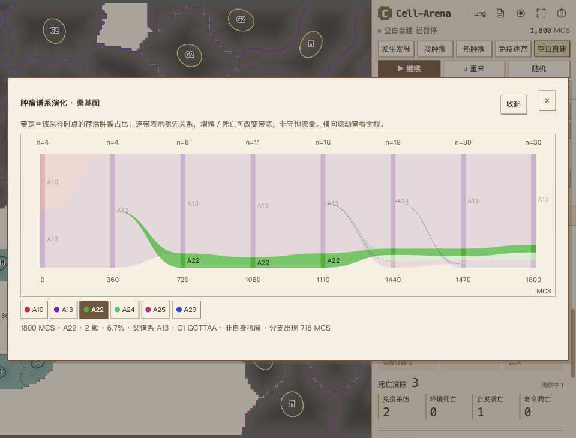

# 单抗原槽与肿瘤演化桑基图

日期：2026-11-13。模型修订：`2026-11-single-antigen-lineage-3`。对照版本：`1712e0343670c40a9501e9f7678ae55c3ef1f2c5`。本轮按用户决定移除四槽运行模式，不把旧版轨迹等价作为转换目标。

## 实际改变

每个细胞的遗传配方只有一个肽抗原槽。序列突变将 A 替换为 B，子代继承；A 不会作为第二个抗原保留。遗传丢失后该槽不表达，普通序列替换不会修复丢失。保留一次总分裂突变机会及各事件的分类权重，没有为达到旧版清除结果提高杀伤率或修改预设数值。

四种自身参考序列、两个呈递通道、两个独立表面靶标仍然存在，均不是每个细胞的额外抗原槽。一个免疫细胞仍有一个稳定受体，多色胞体外轮廓表示这个受体对场内不同抗原的交叉识别。

这是一项生物模型简化：单槽可以表现替换、交叉识别、表达隐藏、呈递障碍、遗传丢失和免疫选择，但无法表现同一细胞同时保留多个独立肽抗原及丢失部分抗原后被其他肽抗原继续识别。没有增加实体 APC、免疫细胞间的抗原转移或真实肽加工过程。

## 图表如何阅读

在“统计”的细胞数量曲线下方查看“肿瘤谱系演化 · 桑基图”，可展开。编号或色带可选择，左右方向键切换采样时点，上下方向键切换谱系；手机支持横向滚动。

- 带宽是该采样时点**存活肿瘤**的占比，上方 `n` 是分母。清除中的胞体不计入，因此可能小于上方人口曲线中的肿瘤数。
- 连带表示遗传来源。增殖与死亡会改变两端宽度，**不是守恒的细胞迁移流量**。各列按采样顺序排列，实际 MCS 标在下方，横向间距不表示相同时间长度。
- 序列、通道身份或存在状态改变建立抗原分支 `A编号`。单纯改变表达或增殖性状仍属于同一抗原分支，完整遗传克隆家谱另存。
- 抗原颜色与胞体外轮廓一致。独立起源、趋同突变和回变即使同色也保留各自分支 ID 与祖先；已灭绝祖先不会因当前计数为零被删除。自身／遗传缺失分支显示中性色，详情说明区别。
- 页面展示历史峰值最高的 12 条分支，其余合并为“其他”，计数与比例不丢失。每条显示分支至少保留一个已采样峰值。通常每 30 MCS 采样，超过 512 行压缩，可能遗漏短暂分支；导出保留全部遗传家谱和仍保留的全部历史样本，不承诺每个 MCS 的记录。

桌面截图来自演示 `04-clonal-replacement.json` 实际运行到 1,800 MCS：存活肿瘤 30，A13 为 24、A22 为 2、A24 为 2、A25 与 A29 各 1。A22 的直接父分支为 A13，产生于 718 MCS；A10 已消失但历史仍显示。截图不是合成数据。



[手机横向滚动与分支详情截图](sankey-mobile.png) · [浏览器检查记录](visual-checks.json)

## 旧文件与新导出

新导出采用 schema 3；新配方若包含多个肽抗原会被拒绝。schema 1/2 的四槽配方先完整校验，再只保留 P1 及其表达值，P2–P4 不参与新实验。导入确认窗口在加载前显示该提示，原文件保持原样。旧的历局回放也保留原 schema，使迁移可被检测。

导入和回放是按配方、种子与参数重新开局，不是恢复网格、随机流或所有手动操作的检查点；新规则不能复现四槽的原轨迹。历史 Git 版本与历史报告保留，但页面没有四槽开关。

## 默认场景的真实对照

两版均用种子 17、31、77，240×180 模型区域、1.5× 精细度、循环边界、35 步预热和 WASM CPM。冷热运行至 3,000 MCS，发生发展至 6,000 MCS，未干预基因或参数。总计 18 局。下表每组数值按上述种子排序。

| 场景／终点 | 四槽：存活肿瘤 | 单槽：存活肿瘤 | 四槽：累计免疫杀伤 | 单槽：累计免疫杀伤 | 四槽→单槽：激活免疫峰值 |
|---|---|---|---|---|---|
| 冷肿瘤／3,000 | 47 / 48 / 42 | 47 / 44 / 45 | 0 / 0 / 0 | 0 / 0 / 0 | 0 / 0 / 0 → 0 / 0 / 0 |
| 热肿瘤／3,000 | 7 / 2 / 26 | 45 / 32 / 25 | 39 / 40 / 34 | 24 / 30 / 32 | 17 / 21 / 14 → 12 / 17 / 14 |
| 发生发展／6,000 | 9 / 10 / 6 | 7 / 9 / 10 | 0 / 0 / 0 | 0 / 0 / 0 | 0 / 0 / 0 → 0 / 0 / 0 |

原始记录：[四槽冷](four-cold.json)、[单槽冷](single-cold.json)、[四槽热](four-hot.json)、[单槽热](single-hot.json)、[四槽发生发展](four-onset.json)、[单槽发生发展](single-onset.json)。各文件含源文件 SHA256、全部有效参数、每 500 MCS 采样、接触受限原因、启动与死亡记录。

这些样本显示冷肿瘤继续扩张，热肿瘤仍有接触杀伤但控制能力总体弱于旧版；因此热场景名称改为“免疫热肿瘤应答”，不暗示必然治愈。发生发展的低激活问题仍存在：单槽终点的现存免疫有效匹配靶细胞数为 0 / 0 / 0。**本轮没有解决有限受体覆盖不足，也没有完成临床校准。**

槽位变化会改变基因初始化及遗传随机流的消耗，同一数值种子不等于两版逐细胞初始抗原相同。以上是版本级行为对照，不是纯单变量因果实验；三个种子不足以估算清除概率。计时含观测开销、部分任务并发，不能据此宣称性能提升。

对照复现方式（Node 24，在项目根目录）：

```sh
node scripts/probe-onset-immunity.mjs --source-revision=1712e0343670c40a9501e9f7678ae55c3ef1f2c5 --scene=hot --until=3000 --seeds=17,31,77 --label=four-hot --out=output/single-antigen-recheck
node scripts/probe-onset-immunity.mjs --scene=hot --until=3000 --seeds=17,31,77 --label=single-hot --out=output/single-antigen-recheck
```

将 `scene` 改为 `cold` 或 `oncogenesis` 并相应更改标签；发生发展使用 `until=6000`。报告生成后新增的历史压缩标志、图表与名称文字不改变这些模拟数值；原始数据中的源哈希保留测量时版本证据。

## 验证

- 全部 398 项 Node 测试通过。新增检查覆盖唯一槽在所有分裂事件中保持、非抗原性状不拆分抗原分支、回变与独立起源不合并、已灭绝祖先、其他分组守恒、完全灭绝、同刻采样替换、迁移不修改输入以及观察不消耗两条随机流。
- 旧版两个固定种子“默认热肿瘤必然清除／早期杀伤达到阈值”的断言不再适用。机制测试改用明确抗原—受体匹配且关闭自发突变的培养体系，仍检查真实接触杀伤、细胞尸体清除后的观察间隔、明确引入的抗原丢失及子代扩张；默认场景结果完整记录于上表，没有将结果差异藏入阈值调整。
- 最后的导入预览与文案修改后，重跑单槽／谱系／抗原颜色／中英翻译／遗传序列化／构建可移植性相关测试，全部通过；`node scripts/verify-build.mjs` 通过。
- Ego Lite 实际浏览器验证：真实 1,800 MCS 演化、展开与收起位置、编号选择和方向键切换、单槽选择面板、schema 3 导出、旧四槽导入前提示、单色肿瘤与交叉识别免疫多色胞体、390×844 手机图表滚动、中英文切换。页面／Worker 无报错，图表交互后时间仍为 1,800 MCS。
- 使用 M5 的 WebGL 显示；浏览器演化演示采用 CPU 场计算，CPM 及其他物理机制照常执行。此次没有声明 GPU CPM 生物学等价或额外性能收益。
